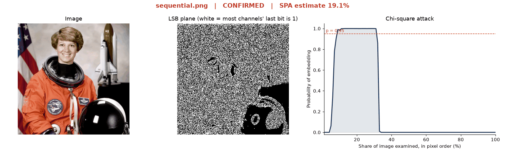
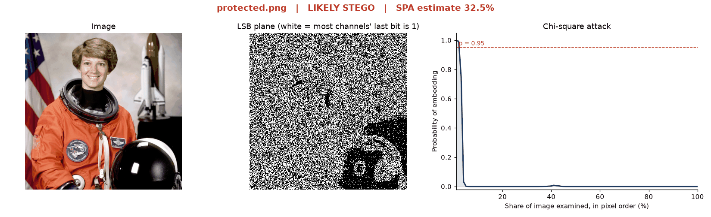

# LSB Steganography: Hide, Reveal & Detect

A Python toolkit that covers both sides of image steganography. It **hides** text or files in the least significant bits of a PNG, **recovers** them (optionally protected by a password), and, most importantly for forensics, **detects** hidden data in images it has never seen before using two classic statistical attacks.



*A 30 KB file hidden in a 512×512 photo. The image looks unchanged, but the LSB plane (middle) has lost the structure that remains visible lower down, and the chi-square attack (right) shows the data stops about 30% of the way through the image.*

## Features

| Command | What it does |
| --- | --- |
| `hide` | Embeds a message or any file in the RGB least significant bits. Each colour value changes by at most 1 |
| `reveal` | Extracts the payload. Works with or without a password |
| `analyze` | Runs steganalysis and gives a verdict of **CLEAN**, **SUSPICIOUS**, **LIKELY STEGO** or **CONFIRMED**, an estimated payload size, and an optional forensic figure |
| `capacity` | Shows how many bytes an image can hold |

### How detection works

1. **Signature check.** If the image contains this tool's unprotected header, the payload is read directly, giving a **CONFIRMED** verdict.
2. **Chi-square attack** (Westfeld & Pfitzmann, 1999). Writing random bits into LSBs makes each value pair (2k, 2k+1), such as 100 and 101, appear equally often. Natural images don't do this. Running the test over growing portions of the image shows where sequentially written data ends.
3. **Sample Pair Analysis** (Dumitrescu, Wu & Wang, 2003). Studies how adjacent pixel pairs move between groups when LSBs are flipped, and solves a quadratic equation to **estimate the share of colour values carrying hidden bits**. It still works when a password scatters the bits randomly, and on the sample it estimated 31,959 bytes against the true 30,000.
4. **LSB randomness.** Measures whether the LSB plane is statistically indistinguishable from coin flips. This catches images filled to capacity, which is where Sample Pair Analysis becomes unreliable.

## Quick start

```bash
git clone https://github.com/keerthyw/stego-lsb-detector.git
cd stego-lsb-detector
python3 -m venv .venv && source .venv/bin/activate
pip install -r requirements.txt

python stego.py capacity samples/cover.png
python stego.py hide samples/cover.png -m "meet at 6" -o secret.png
python stego.py reveal secret.png
python stego.py hide samples/cover.png -f notes.pdf -o secret.png --password hunter2
python stego.py reveal secret.png --password hunter2 -o recovered.pdf

python stego.py analyze samples/*.png
python stego.py analyze samples/protected.png --plot report.png
```

Example output:

```
=== samples/protected.png ===
Verdict:        LIKELY STEGO
SPA estimate:   32.5% of colour values  (R 32.3%, G 33.0%, B 32.2%)
Chi-square p:   0.000 over the whole image
LSB randomness: 0.0800  (0 = indistinguishable from coin flips)
Estimated size: ~31,959 bytes
  - Sample Pair Analysis estimates 32.5% of colour values carry hidden bits (R 32.3%, G 33.0%, B 32.2%).
```

## Samples

| File | Contents | Verdict |
| --- | --- | --- |
| `samples/cover.png` | Original image (NASA, public domain) | CLEAN |
| `samples/secret_message.png` | A 41-byte text message, no password | CONFIRMED, message recovered |
| `samples/protected.png` | 30 KB of compressed data, scattered with the password `srm2026` | LIKELY STEGO, about 32 KB estimated |



## Accuracy

The detection thresholds were calibrated on clean and stego versions of the ten colour test images that ship with scikit-image:

| Payload | Result |
| --- | --- |
| None (clean) | 9 of 10 rated CLEAN. One mostly black astronomy photo was rated SUSPICIOUS |
| 3% of capacity, scattered | 6 of 10 flagged (near the detection limit) |
| 5% of capacity, scattered | Flagged on all 10 (9 SUSPICIOUS, 1 LIKELY STEGO) |
| 25% or 100%, scattered or sequential | Rated LIKELY STEGO on all 10 |

Payloads smaller than about 2–3% of capacity, such as a short text message in a large photo, change too few values for these statistics to detect. This is a real limitation of LSB steganalysis, not a bug.

## Project layout

```
stego.py              command-line interface
stegolsb/lsb.py       hiding and revealing (bit packing, password scattering)
stegolsb/detect.py    chi-square attack, sample pair analysis, LSB randomness, verdict
stegolsb/visual.py    forensic figure (image, LSB plane, chi-square curve)
samples/              demo images and the script that generates them
tests/                14 unit tests
```

Run the tests with `python -m unittest discover tests`.

## Notes

- Output must be PNG, BMP or TIFF. JPEG compression rewrites pixel values and destroys LSB data, so the tool refuses to save as `.jpg`.
- The password option scatters bits pseudo-randomly and masks them with a SHA-256 keystream. That is enough to defeat casual extraction, but it is not audited encryption, so encrypt sensitive files first.
- Only use this on images you own or are authorised to examine.

## License

MIT
